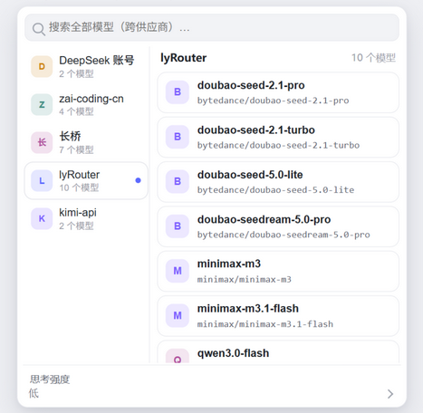

# Two-Level Model Picker · DeepSeek Harness

[中文](README.md) | English

A lightweight, two-column model picker for [DeepSeek Harness (DSH)](https://github.com/deepseek-ai/deepseek-harness). Browse providers on the left, pick from that provider's model cards on the right, with global search and reasoning-effort selection available when you need them.

[Overview](#overview) · [Features](#features) · [Quick start](#quick-start) · [Usage](#usage) · [Compatibility](#compatibility) · [FAQ](#faq) · [Known limitations](#known-limitations)

## Overview

A flat model list becomes harder to navigate as more providers are configured. This plugin puts providers and models into a single menu: narrow the scope on the left rail and pick a model card on the right, no drill-down pages involved — or search across all providers directly.

It replaces the model picker in the Harness composer while using the host's existing model directory and session-selection service. Providers and models remain managed by Harness, and the built-in /model command remains available.

## Features

| Feature | Description |
|---|---|
| Two-column browsing | The left rail shows providers with a logo, model counts and a current-provider indicator; the right pane shows model cards with a vendor accent, display name and full id |
| Global search | Search spans all providers and each hit shows its source provider; matching is case-insensitive and supports fuzzy queries |
| Reasoning effort | Choose an available effort level for supported models and remember successful preferences within the running application |
| Current selection | Highlight the current provider and model and update the composer after a successful selection |
| Keyboard controls | Navigate with ↑↓, confirm with Enter, and clear search, go back or close with Esc |
| Host integration | Follow the host theme, reposition on window changes, and dismiss on outside clicks |
| Error feedback | Keep the menu open on selection failure and show diagnostics when the directory is unavailable |

### Preview

The image is rendered with the shipped styles for illustration. Available providers and models depend on your Harness configuration.

## Quick start

### Install

Install from npm:

~~~sh
dsh plugin --profile desktop add @codewei823/dsh-model-picker-2level
~~~

Download the source and run the following from the project directory:

~~~sh
dsh plugin --profile desktop add .
~~~

Alternatively, install a local plugin archive, replacing the path with the downloaded file:

~~~sh
dsh plugin --profile desktop add ./plugin.tgz
~~~

desktop is an example profile name; replace it with your active profile. Restart the entire Harness application after installation. No build step or development dependencies are needed to install the plugin locally.

### Uninstall

~~~sh
dsh plugin --profile desktop remove @codewei823/dsh-model-picker-2level
~~~

Restart Harness to restore its original model picker.

## Usage

1. Click the model button in the composer. The left rail lists the providers; the right pane shows the current provider's models.
2. Click another provider on the rail to switch the right pane. Browsing alone does not change the active model.
3. Select a model card. On success, the menu closes and the composer reflects the new selection.
4. For a model that supports reasoning, open the reasoning-effort entry at the bottom and choose an available level.

Search spans all providers and each hit shows its source provider. Clearing the query restores the browsed provider's models. Provider ordering follows the host: account and official providers come first, followed by the remaining providers in directory order. Unfiltered models retain directory order.

### Keyboard controls

| Key | Action |
|---|---|
| ↑ / ↓ | Move the model-card highlight without selecting |
| Enter | Open the menu from the model button; confirm the highlighted model / effort; activate a focused button |
| Esc | Clear a nonempty search first; from the effort pane return to the model cards; otherwise close the menu |
| Space | Enter text in the search field; does not activate plugin buttons |
| Tab / Shift+Tab | Keep the browser's existing focus behavior; no custom plugin action |

Confirming an IME composition does not submit a selection.

## Compatibility

- DSH runtime: declared for 0.2.1-rc.3 and every later 0.2.x version (engines.dsh range `^0.2.1-rc.3`). Check your version with dsh --version.
- Interface: the Harness Web interface, including the Web interface inside the desktop application.
- Providers: those already configured in Harness and exposed through its model directory.
- Subagent sessions: the model button is disabled in these sessions.

Compatibility with other runtime versions and platforms is not currently declared.

## FAQ

**Why does the interface look unchanged after installation?**

Restart the entire Harness application and confirm that the plugin was installed in the active profile. Client modules do not hot-reload.

**Do I need to configure providers or API keys again?**

No. The plugin uses the host's existing directory and does not manage credentials.

**Are reasoning-effort preferences permanent?**

Preferences are shared by provider and model within the running application. After a restart, the current session selection is whatever the host restores.

**How do I retry a failed selection?**

The menu keeps the error visible. Retry in the selection-error bar reloads the directory; select the target again to resubmit. Retry in the unavailable-directory diagnostic panel attempts to resolve the directory service again.

## Known limitations

- No plugin settings panel or open / transition animations.
- Screen-reader announcements of highlighted items are incomplete.
- No dedicated reload-all-directories button; loading and caching are managed by the host.
- Host upgrades may affect compatibility. Refer to the declared runtime version.

## Contributing and license

Bug reports and improvements are welcome. See the [contribution guide (Chinese)](CONTRIBUTING.md).

Released under the [MIT License](LICENSE). This is a community plugin for DeepSeek Harness.
