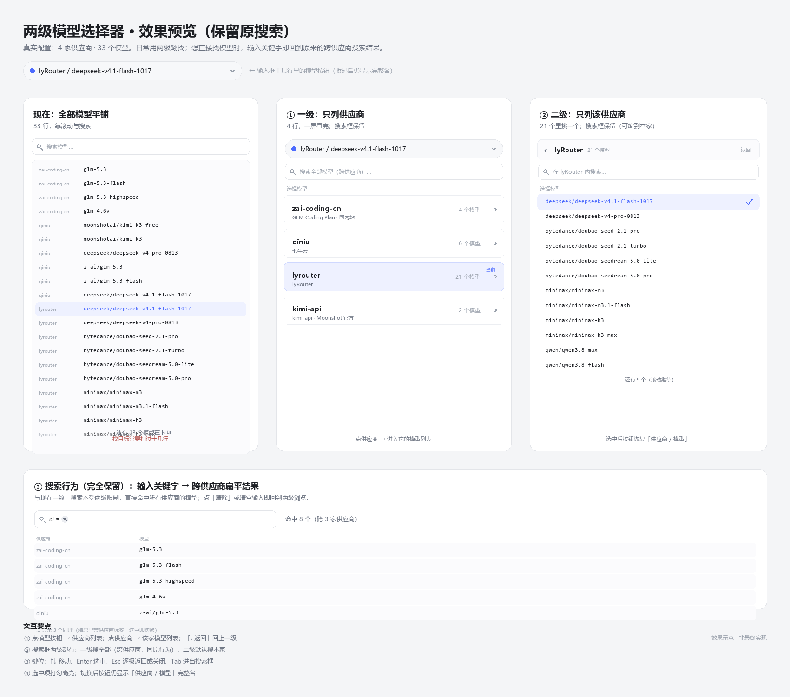

# dsh-model-picker-2level

给 [DeepSeek Harness](https://github.com/deepseek-ai/deepseek-harness) 的两级模型选择器：先选供应商，再选该供应商下的模型。



> **当前版本 `0.1.4` —— 功能可用，已实测通过。**
> 存档说明见 [docs/releases/v0.1.4.md](docs/releases/v0.1.4.md)。

## 为什么

配置了多家模型供应商之后，模型下拉会变成一个长长的平铺列表。以本项目开发时的真实配置为例：4 家供应商、约 33 个可选模型，找目标模型需要滚动逐条扫描。

本插件把选择拆成两级：

```
① 供应商   zai-coding-cn · qiniu · lyrouter · kimi-api
                ↓ 点选
② 模型     lyrouter 下的 21 个模型（只列本家）
```

## 特性

- **两级导航**：一级只列供应商（含别名、模型数、「当前使用」徽章），二级只列该家模型
- **浏览与使用解耦**：一级点哪家就浏览哪家，与当前在用的供应商无关
- **保留原搜索**：一级可跨全部供应商搜索；二级搜索只搜本家
- **思考强度可记忆**：按模型记住选择，切走再切回不会重置为「供应商默认」
- **当前项聚焦**：打开时自动高亮当前模型
- **配置顺序不变**：列表顺序严格跟随 `llm-pi-ai` 配置，只做强调不做重排
- **键盘可用**：↑↓ 移动、Enter 选中、Esc 逐级返回、Tab 回退、输入法安全
- **点外部关闭**：弹层外任意位置按下即关闭
- **跟随窗口**：最大化/还原/滚动时弹层重新定位，不漂移
- **主题一致**：仅使用 `--dsw-alias-*` 主题令牌，跟随亮/暗色切换
- **失败可诊断**：目录不可用时按钮变红、可点开看完整错误并重试

## 状态

| 阶段 | 状态 |
|---|---|
| 设计方案 | ✅ → [docs/design.md](docs/design.md) |
| M1 Spike 验证 | ✅ → [docs/m1-spike-result.md](docs/m1-spike-result.md) |
| M2 MVP | ✅ 已实测通过 → [docs/m2-implementation.md](docs/m2-implementation.md) |
| M3 打磨 | 🟡 部分（键盘/无障碍/i18n 已做；动画、Config、像素级对齐待办） |
| 版本存档 | ✅ v0.1.4 → [docs/releases/v0.1.4.md](docs/releases/v0.1.4.md) |

**接手开发请按此顺序读**：

1. 本文件（是什么、怎么跑）
2. [docs/releases/v0.1.4.md](docs/releases/v0.1.4.md) —— **当前存档：架构事实、代码地图、验证方法、坑**
3. [docs/TASKS.md](docs/TASKS.md) —— 完整任务清单、依赖关系、验收标准
4. [docs/design.md](docs/design.md) + [docs/decisions.md](docs/decisions.md) —— 设计与决策依据（**不要轻易推翻**）

## 安装

本插件当前**未发布到 npm**，用本地目录安装：

```bash
# 本地目录安装（开发期）；装完必须重启桌面应用
dsh plugin --profile desktop add "D:/vibe_coding/dsh-plugin-develop"
```

也可在会话里用 `plugin_manager` 工具安装：`install_bundle target=D:\vibe_coding\dsh-plugin-develop`。

卸载：

```bash
dsh plugin --profile desktop remove @local/dsh-model-picker-2level
```

卸载与回滚的详细验证步骤见 [docs/releases/v0.1.4.md §6](docs/releases/v0.1.4.md)。

## 开发

```bash
# 清单与入口校验
node scripts/validate.mjs

# 纯函数与契约测试（29 项）
node test/pure.test.mjs

# 包结构测试（8 项）
node test/package.test.mjs
```

> 若 `npm test` 因沙箱禁止派生子进程报 `spawn EPERM`，直接 `node <file>` 执行即可，效果等价。

本项目**无构建步骤**：`client.js` 直接以 `window.__ModuleLoader__.load(...)` 形式交付，仓库内提交的就是运行产物。

> ⚠️ **改完 `client.js` 必须重启桌面应用**才能验证（客户端模块无热重载）。
> 纯函数已抽到 `__pure` 导出并用 `node:vm` 单测，尽量用测试替代重启。

## 项目结构

```
.
├─ .github/                     GitHub 模板与 CI
├─ docs/
│  ├─ releases/v0.1.4.md        ★ 当前版本存档（接手先读这个）
│  ├─ TASKS.md                  ★ 开发任务清单
│  ├─ design.md                 设计方案
│  ├─ decisions.md              决策记录（ADR）
│  ├─ m1-spike-plan.md          M1 验证方案
│  ├─ m1-spike-result.md        M1 实测结论
│  ├─ m2-implementation.md      M2 实现记录 + 修复记录
│  └─ assets/                   效果图
├─ locale/                      Store 元数据（UI 字典内联在 client.js）
├─ scripts/validate.mjs         清单与入口校验
├─ test/                        Node 内置 test runner
├─ client.js                    浏览器半（纯函数 + 样式 + 组件 + 注册）
├─ cordis.patch.yml             Loader patch：把插件插进 profile
├─ icon.svg                     插件图标
├─ index.js                     Host 半（空实现）
└─ package.json                 含 dsh.bundle / dsh.client 声明
```

## 实现要点

| 关注点 | 做法 |
|---|---|
| 模型目录数据 | 复用内置 `modelDirectories` 服务，不自建状态 |
| 注入依赖 | `['slots','modelDirectories','sessions','remote','remote.session']`（**`remote` 不能少**） |
| 选择写回 | 复用 `directory.select()`，与 `/model` 走同一条路径 |
| 座位 | 注册到 `conversation.input.model`（单例 Slot），并重新声明 `.label` 子 Slot |
| 数据来源 | 全部来自 Host 投影，插件不 fold 会话事件 |
| 样式 | 只用 `--dsw-alias-*` 令牌，类名 `dmp-` 前缀 |

原理与踩坑细节见 [docs/design.md](docs/design.md) 第 6 章与
[docs/releases/v0.1.4.md](docs/releases/v0.1.4.md) 第 2 章。

## 已知限制

- 无打开/切层动画
- 插件 Config 未接线（搜索范围、计数显示等为硬编码默认值）
- `aria-activedescendant` 未实现
- 思考强度记忆仅在当前应用进程内有效
- 未发布 npm

## 贡献

见 [CONTRIBUTING.md](CONTRIBUTING.md)。提交前请确认校验与三套测试全绿。

## 许可证

[MIT](LICENSE)
