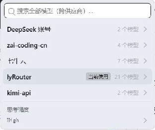
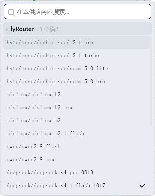

# 两级模型选择器 · DeepSeek Harness

中文 | [English](README.en.md)

为 [DeepSeek Harness（DSH）](https://github.com/deepseek-ai/deepseek-harness) 提供轻量的两级模型选择入口：先选供应商，再选模型。保留全局搜索和思考强度选择，让多供应商环境下的模型切换更清晰。

[是什么](#是什么) · [功能](#功能) · [快速上手](#快速上手) · [使用方法](#使用方法) · [兼容性与运行环境](#兼容性与运行环境) · [常见问题](#常见问题) · [已知限制](#已知限制)

## 是什么

配置多家模型供应商后，平铺的模型列表会变得很长。两级模型选择器将列表拆分为供应商页和模型页，先缩小范围，再选择目标模型；也可以直接搜索全部模型。

插件使用 Harness 已有的模型目录和会话选择能力，替换输入区的模型选择界面。供应商与模型仍由 Harness 配置和管理，内置的 /model 命令保持可用。

## 功能

| 能力 | 说明 |
|---|---|
| 两级导航 | 供应商页显示模型数量和当前使用标记，模型页只列出该家的模型 |
| 分层搜索 | 首页搜索全部供应商，模型页仅搜索本家；支持大小写无关和模糊匹配 |
| 思考强度 | 为支持推理的模型选择强度，并在当前应用进程内记忆成功选择的偏好 |
| 当前项提示 | 高亮当前供应商和模型，切换后同步更新输入区显示 |
| 键盘操作 | ↑↓ 移动，Enter 打开或确认，Esc 清空搜索、返回或关闭 |
| 界面适配 | 跟随宿主主题，窗口变化时重新定位，点击外部关闭 |
| 错误反馈 | 选择失败时保留菜单，目录不可用时提供诊断和重试入口 |

### 界面预览

| 供应商列表 | 模型列表 |
|---|---|
|  |  |

截图中的供应商和模型仅展示界面，实际列表以 Harness 中的配置为准。

## 快速上手

### 安装

下载插件源码并进入项目目录后，执行：

~~~sh
dsh plugin --profile desktop add .
~~~

也可以安装本地插件归档文件，将路径替换为实际下载的文件：

~~~sh
dsh plugin --profile desktop add ./plugin.tgz
~~~

desktop 为 profile 示例，使用其他 profile 时替换名称。安装后重启整个 Harness。插件无需构建，本地安装不需要先安装开发依赖。

### 卸载

~~~sh
dsh plugin --profile desktop remove @codewei823/dsh-model-picker-2level
~~~

卸载后重启 Harness，恢复宿主原有的模型选择器。

## 使用方法

1. 点击输入区的模型按钮，查看供应商列表。
2. 选择供应商，进入该供应商的模型列表。单纯浏览不会改变当前模型。
3. 点击目标模型，成功后菜单关闭，输入区显示新选择。
4. 需要调整推理强度时，在供应商首页打开“思考强度”，选择可用档位。

首页搜索跨全部供应商；进入供应商后，搜索范围限定在本家。清空搜索会恢复当前页列表。供应商按宿主规则排列，账号和官方供应商优先，其余保持目录顺序；未搜索的模型保持目录顺序。

### 键盘

| 按键 | 行为 |
|---|---|
| ↑ / ↓ | 移动列表高亮，不提交选择 |
| Enter | 在模型按钮上打开菜单；进入高亮供应商或确认模型 / 强度；按钮有焦点时激活该按钮 |
| Esc | 搜索有文字先清空；为空时返回供应商首页，首页则关闭 |
| 空格 | 搜索框中输入文字，不激活插件按钮 |
| Tab / Shift+Tab | 保留浏览器原有焦点行为，无插件自定义动作 |

输入法组字确认不会触发选择。更多操作见 [用户指南](docs/usage.md)。

## 兼容性与运行环境

- DSH 运行时：当前声明支持 0.2.1-rc.3，可通过 dsh --version 查看。
- 界面：面向 Harness Web 界面，包括桌面客户端内的 Web 界面。
- 供应商：使用 Harness 已配置并提供到模型目录中的供应商和模型。
- 子代理会话：模型按钮禁用，不能从该入口切换。

其他运行时版本与平台的兼容性尚未声明。

## 常见问题

**安装后为什么界面没有变化？**

重启整个 Harness，并确认插件安装到了当前使用的 profile。客户端模块没有热重载。

**是否需要重新配置供应商或 API Key？**

不需要。插件使用宿主已有目录，不提供凭证管理功能。

**思考强度会一直保存吗？**

偏好记忆仅在当前应用进程内有效，按供应商和模型共享。应用重启后，当前会话实际选择以宿主恢复的状态为准。

**切换失败后如何重试？**

菜单会保留错误信息。选择失败条中的“重试”只重载目录，再次提交需要重新选择目标项；目录不可用诊断面板的“重试”会重新解析目录服务。

## 已知限制

- 无插件配置面板和打开 / 切层动画。
- 读屏对高亮项的宣布尚不完整。
- 尚无独立的刷新全部目录按钮，加载和缓存行为由宿主管理。
- 宿主升级可能影响兼容性，应以声明的运行时版本为准。

## 贡献与许可证

欢迎报告问题或提交改进，参与方式见 [贡献指南](CONTRIBUTING.md)。

本项目使用 [MIT License](LICENSE)，是面向 DeepSeek Harness 的社区插件。
